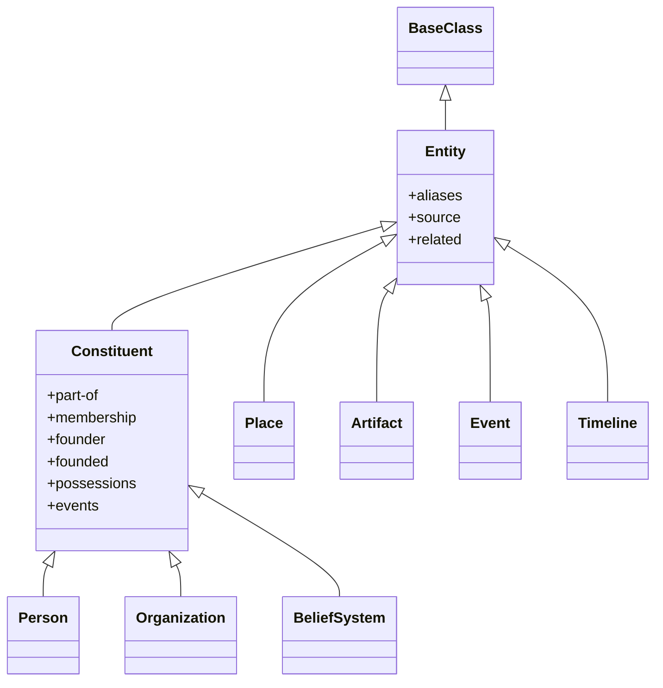
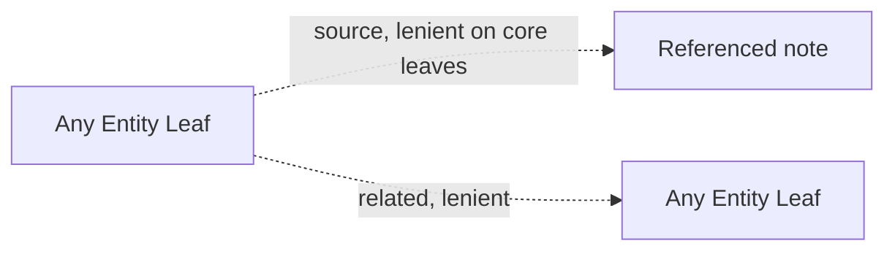
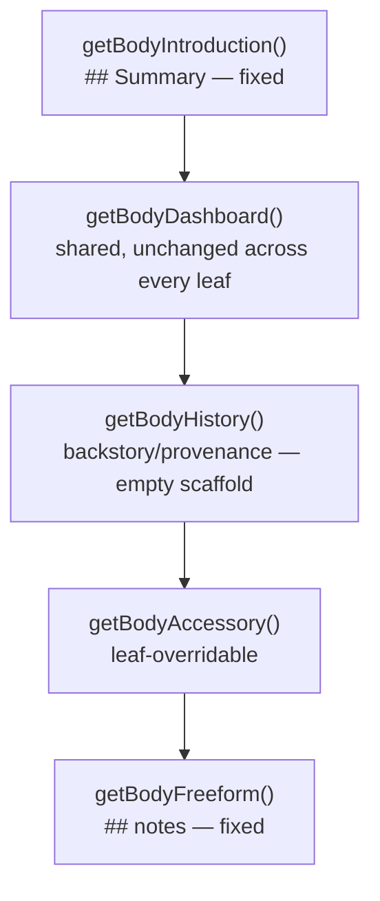
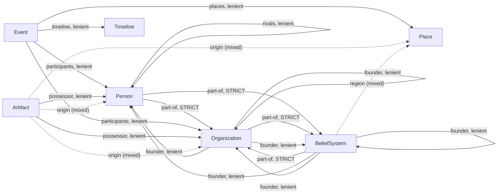
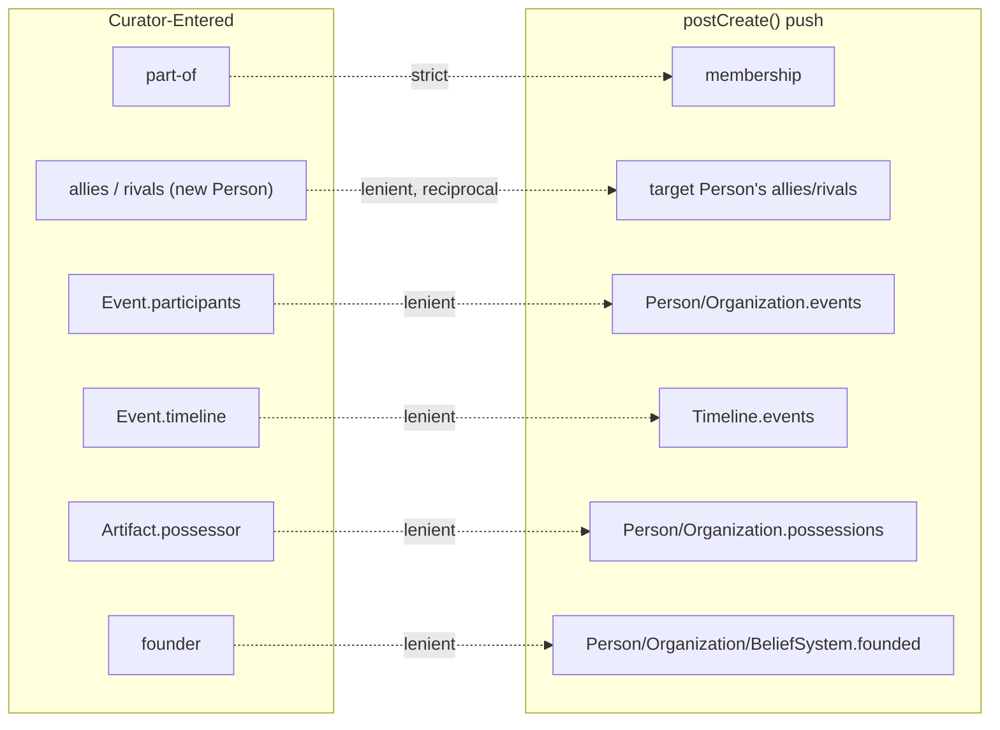

Schema reference and visualization for `Entity.js`, aligned with [[Entity.js Specification]]. Scope matches the specification exactly: `Entity`, `Constituent`, and the seven core leaves. Module-specific extensions (`LibraryEntity`, `CreativeEntity`, etc.) are out of scope for both documents.

## Contents
---
```toc
```

## 1. Legend
---

| Diagram notation | Meaning |
| --- | --- |
| `──►` solid arrow | Relational field, **eager-strict** resolution (throws on unresolved link) |
| `┄┄►` dashed arrow | Relational field, **eager-lenient** resolution (tolerates unresolved link) |
| `····►` dotted arrow | **Accession-only** field — populated by a `postCreate()` push, no modal field |
| `╌╌►` mixed-style arrow | Relational-or-free-text field (`resolveOptionalNoteTitle()`) — relational when bracketed, free text otherwise; throws only if a bracketed value fails to resolve |

## 2. Class Hierarchy
---



- `Entity` and `Constituent` are both real, shared, never-instantiated classes.
- `Person`/`Organization`/`Belief-System` extend `Constituent`. The remaining four leaves extend `Entity` directly.
- All seven leaves are directly instantiable, each with its own creation command — no leaf is abstract.

| Leaf | `class` value |
| --- | --- |
| `Person` | `person` |
| `Organization` | `organization` |
| `Belief-System` | `belief-system` |
| `Place` | `place` |
| `Artifact` | `artifact` |
| `Event` | `event` |
| `Timeline` | `timeline` |

`Entity` and `Constituent` carry no `class` value.

## 3. Entity-Level Shared Fields
---

| Field | Type | Resolution |
| --- | --- | --- |
| `aliases` | string array | Obsidian native property. Not resolved. |
| `source` | wikilink array | Eager. Strictness is module-defined — see [[Entity.js Specification]] §1. The seven core leaves resolve it leniently with `resolveNoteLinksLenient()`: an unresolvable link is kept as written. |
| `related` | wikilink array | Eager-lenient (`resolveNoteLinksLenient()`). |
| `class`, `category`, `affiliations`, `created`, `modified`, `context`, `tags` | — | Standard via `BaseClass`. |

- `category` is written as an array on every leaf, empty when the leaf carries no vocabulary (`Timeline`).
- `context` is never resolved by `Entity`. It is written raw, as entered.
- `created` is set automatically at instantiation.



## 4. Body Composition
---



`getBodyDashboard()` renders a `source` table, a `related` table, and an `affiliations` table listing the other notes that share this note's `affiliations`, without repeating the note's own values, sorted by [[Apparatus Affiliations Taxonomy]] category prefix. A note shares an affiliation when its own `affiliations` contains a value recorded in this note's `affiliations`. This is the only body section that queries `affiliations` directly. Leaf-specific tables live in `getBodyAccessory()` ([[Entity.js Specification#`getBodyAccessory()` content by leaf|§9]]).

Dashboard and Accessory tables are Dataview queries in the minimal form `TABLE WITHOUT ID file.link AS Title, <field> AS <Label>`. Column sets are deferred until objects have been instantiated. Each table is one of two kinds:

- **Table A** lists the notes in this note's own `<field>`.
- **Table B** lists the notes whose own `<field>` links to this note, which surfaces links that are not reciprocated. `source`, `related`, `allies`, and `rivals` use Table B.

Every Accession-only field gets both tables. Table A shows what Accession pushed. Table B queries the counterpart field that points at this note, so a push that Accession missed shows as a difference between the two. No tables are raised for the other curator-entered fields, since frontmatter already shows what they point at.

| Accession-only field | Counterpart queried by Table B |
| --- | --- |
| `membership` | `part-of` |
| `founded` | `founder` |
| `possessions` | `possessor` |
| `events` | `participants` on `Person`/`Organization`; `timeline` on `Timeline` |

| Leaf | `getBodyAccessory()` content |
| --- | --- |
| `Person` | Table B for `allies`, `rivals`; A and B tables for `possessions`, `founded`. |
| `Organization` | A and B tables for `membership`, `founded`, `possessions`. |
| `Belief-System` | Postulates/doctrine prose; A and B tables for `membership`, `founded`. |
| `Place` | Not overridden. |
| `Artifact` | Not overridden. |
| `Event` | Not overridden. |
| `Timeline` | A and B tables for `events`. |

## 5. Constituent Fields
---

| Field | Type | Resolution | Curator-enterable? |
| --- | --- | --- | --- |
| `part-of` | wikilink array | Eager-strict | Yes — the sole curator-enterable side. |
| `membership` | wikilink array | — | No. Accession-only; reverse of `part-of`. |
| `founder` | wikilink array | Eager-lenient, triple-class (`Person`/`Organization`/`Belief-System`) | Yes — `Organization`/`Belief-System` only. |
| `founded` | wikilink array | — | No. Accession-only; reverse of `founder`. |
| `possessions` | wikilink array | — | No. Accession-only; reverse of `Artifact.possessor`. |
| `events` | wikilink array | — | No. Accession-only; reverse of `Event.participants`. |

`Organization` uses all six; `Person` uses `part-of`/`founded`/`possessions`/`events`; `Belief-System` uses `part-of`/`membership`/`founder`/`founded`.

## 6. Per-Leaf Field Schemas
---

### Frontmatter order

General order for every leaf: `class`, `category`, `affiliations`, `aliases`, `created`, `modified`, {leaf fields}, `source`, `related`, `context`, `tags`. Modals build their fields in the same order.

| Leaf | Leaf fields, in order |
| --- | --- |
| `Person` | `alignment-ethics`, `alignment-morality`, `role`, `occupation`, `significance`, `part-of`, `allies`, `rivals`, `founded`, `possessions`, `events` |
| `Organization` | `membership`, `part-of`, `founder`, `founded`, `possessions`, `events` |
| `Belief-System` | `date-start`, `date-end`, `region`, `membership`, `part-of`, `founder`, `founded` |
| `Place` | None. |
| `Artifact` | `origin`, `condition`, `possessor` |
| `Event` | `date-start`, `date-end`, `timeline`, `places`, `participants` |
| `Timeline` | `date-start`, `date-end`, `events` |

### 6.1 Person

| Field | Type | Kind | Resolution / Vocabulary |
| --- | --- | --- | --- |
| `category` | string array | controlled vocabulary, pick-one, optional | `real`/`fictional` |
| `role` | string | free text | — |
| `significance` | string | free text | — |
| `occupation` | string | free text | — |
| `alignment-ethics` | string | controlled vocabulary | `lawful`/`neutral`/`chaotic` |
| `alignment-morality` | string | controlled vocabulary | `good`/`neutral`/`evil` |
| `allies` | wikilink array | relational | Eager-lenient, scoped to `Person`. |
| `rivals` | wikilink array | relational | Eager-lenient, scoped to `Person`. |
| `part-of`, `founded`, `possessions`, `events` | — | via `Constituent` | See §5. |

Naming convention: last name, first name. No split name fields.

### 6.2 Organization

| Field | Type | Kind | Resolution / Vocabulary |
| --- | --- | --- | --- |
| `category` | string array | controlled vocabulary, open-ended | Starting values: `family`/`faction`/`political-party`/`guild`. Not closed: the modal renders a comma-separated list with suggestions scoped to existing `organization` notes. |
| `part-of`, `membership`, `founder`, `founded`, `possessions`, `events` | — | via `Constituent` | See §5 — the only leaf using all six. |

### 6.3 Belief-System

| Field | Type | Kind | Resolution / Vocabulary |
| --- | --- | --- | --- |
| `category` | string array | controlled vocabulary, 4 axes, 2 conditional | Domain (pick-one, required): `political`/`religious`. Political sub-axis (shown only if `political`): `first-party`/`third-party`/`independent`. Religious sub-axis (shown only if `religious`): `mainstream`/`denomination`/`cult`/`individual`. Ethical leaning (stackable): `benevolent`/`benevolent-neutral`/`neutral`/`neutral-malevolent`/`malevolent`. |
| `date-start` / `date-end` | date | date picker (`YYYY-MM-DD`) | Optional; absent `date-end` implies a single point. |
| `region` | wikilink or string | mixed | `resolveOptionalNoteTitle()`, scoped to `Place`. |
| `part-of`, `membership`, `founder`, `founded` | — | via `Constituent` | See §5. No `possessions`/`events`. |

### 6.4 Place

| Field | Type | Kind | Resolution / Vocabulary |
| --- | --- | --- | --- |
| `category` | string array | controlled vocabulary, pick-one, optional | `region`/`settlement`/`landmark`/`structure` |

No fields beyond `Entity`/`BaseClass`. Containment uses `related`.

### 6.5 Artifact

| Field | Type | Kind | Resolution / Vocabulary |
| --- | --- | --- | --- |
| `category` | string array | controlled vocabulary, 2 stackable + 1 pick-one (optional) | Nature (stackable): `mundane`/`technological`/`supernatural`. Function (stackable): `weapon`/`relic`/`document`/`tool`. Temperament (pick-one, optional): `cursed`/`blessed`/`neutral`. |
| `possessor` | wikilink array | relational | Eager-lenient, dual-class: `Person`/`Organization`. |
| `origin` | wikilink or string | mixed | `resolveOptionalNoteTitle()`, `NoteSuggest`-scoped to `Person`/`Place`/`Organization`. |
| `condition` | string | controlled vocabulary | `intact`/`damaged`/`lost`/`destroyed`/`unknown`/`hidden` |

### 6.6 Event

| Field | Type | Kind | Resolution / Vocabulary |
| --- | --- | --- | --- |
| `category` | string array | controlled vocabulary, 2 stackable | Scale: `personal`/`local`/`regional`/`world-historic`. Nature: `war`/`disaster`/`political`/`discovery`/`ritual`. |
| `date-start` | date | date picker (`YYYY-MM-DD`) | Key always written; value may be empty. |
| `date-end` | date | date picker (`YYYY-MM-DD`) | Optional; absence implies single-day/point event. |
| `participants` | wikilink array | relational | Eager-lenient, dual-class: `Person`/`Organization`. |
| `places` | wikilink array | relational | Eager-lenient, scoped to `Place`. |
| `timeline` | wikilink (singular) | relational | Eager-lenient, scoped to `Timeline`. |

### 6.7 Timeline

| Field | Type | Kind | Resolution / Vocabulary |
| --- | --- | --- | --- |
| `category` | string array | none | Written as an empty array. |
| `events` | wikilink array | relational | Accession-only, populated from `Event.timeline`. |
| `date-start` / `date-end` | date | date picker (`YYYY-MM-DD`) | Same shape as `Event`; describes the Timeline's own span. |

Subject-tracing uses `related`.

## 7. Relational Connections — Curator-Entered Fields
---



`membership`/`founded`/`possessions`/`events` do not appear here — all four are Accession-only. See §8.

## 8. Accession
---

| Row | Resolves | Pushes into | Target field | Strictness |
| --- | --- | --- | --- | --- |
| 1 | Every wikilink in `part-of` | Each resolved `Organization`/`Belief-System` | `membership` | Strict |
| 2 | A named `Person` in `allies`/`rivals`, at creation time only | The resolved `Person` | `allies`/`rivals` (whichever matched) | Lenient — reciprocal |
| 3 | Every wikilink in `Event.participants` | Each resolved `Person`/`Organization` | `events` | Lenient |
| 4 | The wikilink in `Event.timeline`, if set | The resolved `Timeline` | `events` | Lenient |
| 5 | Every wikilink in `Artifact.possessor` | Each resolved `Person`/`Organization` | `possessions` | Lenient |
| 6 | Every wikilink in `founder` (`Organization`/`Belief-System`) | Each resolved `Person`/`Organization`/`Belief-System` | `founded` | Lenient |



Rows 2–6 resolve each target with `resolveNoteFileLenient()`, which returns `null` for an unresolvable link. The caller logs the miss with `Log.error` and skips that push. Row 2's `Person` is a note that already exists, named in `allies`/`rivals`.

Row 2 is the only reciprocal push — both sides are independently curator-enterable. Every other row is one-sided: one curator-enterable field, one Accession-only field. All pushes are duplicate-safe and throw-and-log on failure without blocking the primary note's creation.

## 9. Open Items
---

Mirrors [[Entity.js Specification]] §10 exactly.

None. Column sets for every table are deferred until objects have been instantiated.

## 10. Change Log
---

| Date | Change |
| --- | --- |
| 2026-10-22 | Realigned to [[Entity.js Specification]] as of this date. Added `aliases` to `Entity` and removed it from `Person`. `source` is lenient on the core leaves (§3). Added `class` values (§2) and frontmatter order (§6). Marked the `Person`/`Place`/`Artifact` category selections optional, `Organization.category` as an open-ended suggest-backed list, and `Timeline.category` as an empty array. Date fields are date pickers; `Event.date-start` is always written but may be empty. Rewrote the dashboard and accessory description in §4: the `affiliations` table, Table A and Table B, and the accessory content by leaf. Added the Accession resolver and logging note to §8. Cleared §9. |
| 2026-10-11 | Realigned to [[Entity.js Specification]] as of this date. Replaced every "Cascade-only" with "Accession-only" (legend, §5, §6.7, §7, §8). Corrected `source`'s resolution note (§3 table and diagram) to module-defined, per Spec §1. `Person.category` finalized as pick-one `real`/`fictional` (§6.1); `Belief-System`'s domain marked required (§6.3). Cleared §9 — both remaining open items closed in the specification. |
| 2026-09-12 | Resolved the "Accession-shaped but not formally Accession" open item, mirroring [[Entity.js Specification]]'s own §5/§10/§11 update: renamed §8 from "Cross-Object Relational Population" to "Accession"; removed the corresponding open item from §9 and renumbered the remaining three. |
| 2026-08-28 | Initial schema document. |
| 2026-08-31 | Full rebuild to align with the finalized [[Entity.js Specification]]. Removed all `LibraryEntity`/`CreativeEntity`/module-branch content — out of scope for both documents now. Corrected the hierarchy diagram (`Constituent` is a single real shared class, not two module-specific realizations with no shared file). Corrected `part-of`/`membership` direction throughout (§7/§8) to match the specification's resolved design. Added `founder`/`founded`, `possessor`/`possessions`, `alignment-ethics`/`alignment-morality`; removed the deprecated `ally.`/`rival.`/`subject.` namespace pattern and the retired `era` field. Added the `getBody()` five-method composition diagram (§4). Replaced the prior open-items list with the five items now tracked in the specification's own §10. |